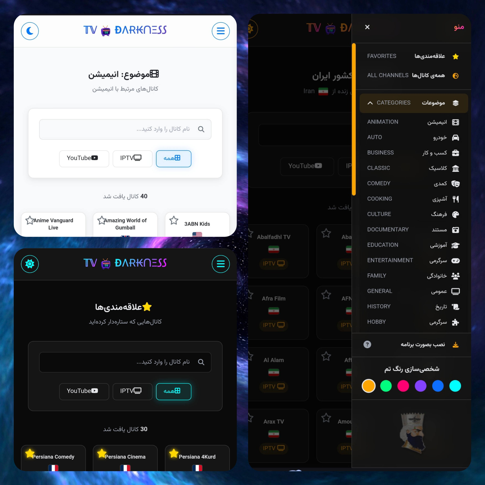

<h1 align="center">$$\color{Gold} \large \text{ÐΛɌ₭ᑎΞ𐒡𐒡 𝕋𝕍}$$</h1>
<h2 align="center">$$\color{cyan} \large \text{تلویزیون آنلاین و رایگان با وب اپلیکیشن}$$</h2>

    

     
   
     

 

### به راحتی به شبکه‌های تلویزیونی از سراسر جهان دسترسی داشته باشید، لیست علاقه‌مندی‌های خود را بسازید و از تماشای بدون وقفه لذت ببرید.

<h3 align="center">$$\color{orange} \large \text{✨ ویژگی‌های کلیدی وبسایت}$$</h3>

   

### وبسایت "ÐΛɌ₭ᑎΞ𐒡𐒡 𝕋𝕍" یک پلتفرم برای تماشای آنلاین شبکه‌های تلویزیونی است که امکانات زیر را ارائه می‌دهد:

#### بیش از ۵۲۰۰ کانال:
- به مجموعه گسترده‌ای از شبکه‌های تلویزیونی از سراسر جهان دسترسی داشته باشید.

#### نکته مهم:
- برای جستجو یک کانال، ابتدا فیلتر را روی "همه ی کانال ها" قرار دهید.

#### تماشای شبکه‌های تلویزیونی: 
- قابلیت اصلی سایت، پخش زنده کانال‌های تلویزیونی از منابع IPTV و یوتیوب است.

#### لیست علاقه‌مندی‌ها (Favorites): 
- می‌توانید کانال‌های مورد علاقه خود را علامت‌گذاری کنید تا همیشه به راحتی در دسترس باشند.

#### دسته‌بندی موضوعی (Categories): 
- شبکه‌ها بر اساس موضوعات مختلف (مانند سرگرمی، ورزشی، خبری و...) دسته‌بندی شده‌اند.

#### دسته‌بندی بر اساس کشور (Countries): 
- به راحتی می‌توانید شبکه‌های مربوط به یک کشور خاص را پیدا کنید.

#### قابلیت نصب (Install as an App): 
- می‌توانید این وبسایت را مانند یک اپلیکیشن مستقل (PWA) بر روی کامپیوتر یا موبایل خود نصب کنید تا دسترسی سریع‌تری داشته باشید.

#### شخصی‌سازی تم رنگی (Theme Color): 
- این امکان وجود دارد که رنگ‌بندی و ظاهر سایت را به سلیقه خود تغییر دهید.

#### جستجوی پیشرفته (Search): 
- با استفاده از قابلیت جستجو، به سرعت کانال مورد نظر خود را پیدا کنید.

#### فیلتر کردن منابع: 
- کانال‌ها را بر اساس منبع پخش (IPTV یا یوتیوب) فیلتر کنید.

   

 
<h1 align="center">$$\color{Gold} \large \text{ÐΛɌ₭ᑎΞ𐒡𐒡 𝕋𝕍}$$</h1>
<h2 align="center">$$\color{cyan} \large \text{ Free online TV with web application }$$</h2>

    

### Easily access TV channels from around the world, create your own favorites list, and enjoy seamless streaming.

 <h3 align="center">$$\color{orange} \large \text{✨ Key Features}$$</h3>

   

### The "ÐΛɌ₭ᑎΞ𐒡𐒡 𝕋𝕍" website is a platform for streaming online TV channels, offering the following features:

##### Over 5200 Channels:
- Access a vast collection of television channels from all over the world.

##### Important Note: 
- To search for a channel, first set the filter to "All Channels."

##### Live TV Streaming: 
- The core functionality is live streaming TV channels from IPTV and YouTube sources.

##### Favorites List: 
- You can mark your favorite channels for quick and easy access at any time.

##### Categorization by Topic (Categories): 
- Channels are sorted into various categories such as Entertainment, Sports, News, etc.

##### Categorization by Country (Countries): 
- Easily find channels belonging to a specific country.

##### Installable as an App: 
- You can install this website as a standalone Progressive Web App (PWA) on your desktop or mobile device for faster access.

##### Theme Color Customization: 
- Change the site's color scheme and appearance to match your preference.

##### Advanced Search: 
- Quickly find the channel you're looking for using the powerful search functionality.

##### Filter by Source: 
-Filter channels based on their streaming source (IPTV or YouTube).

   
   

   

  

   
   
  

